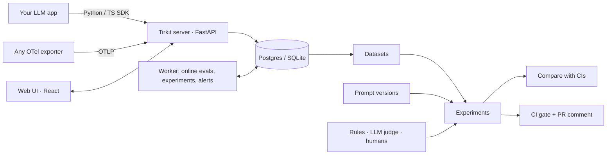

# Tirkit

> Open-source LLM observability and evaluation you can trust: trace every kind of model, turn
> real traffic into test sets, compare changes with confidence intervals, gate CI, and measure
> whether your LLM judge agrees with humans.

**Status:** M0–M10 built (see [PLAN.md](docs/PLAN.md)); outside users and the write-up are next · **Licence:** Apache-2.0 · **Named for:** Tir, the Armenian god of writing, who recorded people's deeds and led them to judgment

## Why Tirkit
Every team shipping LLM features needs to see what their app does in production and to know whether
a change made it better or worse. Most decide by feel, or with an LLM judge nobody has checked.
Tirkit does both observability and evaluation, self-hosted, and it measures properly: every
comparison has a confidence interval, and the judge's agreement with human labels is reported per
rubric version.

## What it does
- **Any model:** text and chat, vision, image generation, embeddings, small and local models (Ollama, LM Studio, vLLM, transformers), speech-to-text, text-to-speech and speech-to-speech, with images and audio stored and playable in the UI.
- **Observe:** Python and TypeScript SDKs, auto-instrumentation for OpenAI (and any OpenAI-compatible server), Anthropic, LangChain and transformers; OpenTelemetry ingest for everything else; sessions, users, cost from a 5,500-model price table, latency percentiles, dashboards, alerts, end-user feedback, PII redaction at ingest.
- **Evaluate:** datasets mined from traces (redacted, de-duplicated, versioned), rule, speech (WER/CER, TTS round-trip) and LLM-judge scorers, experiments, side-by-side comparison with 95% CIs, human annotation queues, online evals on sampled production traffic with a budget, and a CI gate that fails only when a change is confidently worse.
- **Iterate:** versioned prompts with deploy labels (`production`, `staging`) fetched at runtime, and a playground that replays any traced call.
- **Trust:** judge-reliability reports (Cohen's kappa, weighted kappa, position-swap flip rate, length bias) stored per rubric version.

## Quickstart
```bash
docker compose up -d                 # http://localhost:8000: create the admin, then an API key
pip install tirkit
export TIRKIT_HOST=http://localhost:8000 TIRKIT_PUBLIC_KEY=pk-tirkit-... TIRKIT_SECRET_KEY=sk-tirkit-...
```
```python
import tirkit

tirkit.init()
tirkit.instrument()  # OpenAI / Anthropic / transformers calls are now traced
```
More in the [docs](docs/site/quickstart.md): evaluation, CI gating, prompts, self-hosting.

Develop locally:
```bash
make setup && make web         # Python env and the UI build
make serve                     # http://localhost:8000
make dev-seed                  # synthetic dev data on every screen: traces, dataset, experiments, labels, judge reports, prompts, alerts
make test && make lint
```

## The bar: 9/10
A reviewer should be able to see, in five minutes:
- `docker compose up` to a first trace in the UI in under 10 minutes, following the docs
- Real traffic traced through it (your job if allowed, a friend's product, or a client), with online evals running
- The full loop in the UI: trace → dataset → experiment → compare with CIs → CI gate
- Judge–human agreement (Cohen's kappa) measured, then improved by calibration
- Seeded regressions caught by the CI gate (x of N)
- Every comparison reported with a confidence interval, never a single score

## Results
Only measured numbers go here, with how each was measured.

| Metric | Value | How measured |
| --- | --- | --- |
| Judge–human agreement (kappa), before → after calibration | _not measured yet_ | 100 outputs you labelled yourself |
| Position-swap flip rate | **65% → 32%** (30/46 → 14/44 decided pairs; 95% CI 52–78% → 18–46%; paired difference −52 to −16 points) | `research/experiments/e1_judge_bias.py`: Qwen 3.5 9B (local, LM Studio) wrote a one-sentence and a 3–5 sentence answer to each of the 50 questions in `research/evals/acme_qa.jsonl`; the same model judged each pair in both orders with the reference answer, under the built-in `correctness` rubric (v0, e3c5e4ca) and a calibrated rubric (v1, 0128891a: explicit criteria, anchored examples, "ignore order and length"). Ties excluded. v0 showed a strong second-position preference (the answer shown first won 20% of decisions). Same small model as answerer and judge; one run, temperature 0. Raw data: `research/experiments/results/e1_flip_rate.json` |
| Seeded regressions caught | _not measured yet_ | x of N deliberately broken prompts |
| Tracing overhead p99 | **0.024–0.025 ms** added (p50 0.014 ms) | `research/benchmarks/bench_tracing.py`: 10,000 traced calls with a chat payload and token usage vs a bare call, SQLite via the batch exporter, 3 runs on an otherwise idle Apple M3 Pro (no model server, no Docker), Python 3.12; all 10,000 spans stored, 0 dropped. Re-measured 2026-11-16 after prompt linking was added to every span |
| Server ingestion throughput | **1,679–3,105 spans/s**, 0 dropped | `research/benchmarks/bench_ingest.py`: 8 clients posting 100-span batches of ~1 KB chat spans for 30 s to `tirkit serve` (2 workers) on Postgres 16 in Docker, same Apple M3 Pro laptop, 3 runs; spans stored = spans sent every run |
| Trace list query p95 | **47 ms** default view (worst filter: 83 ms) | `research/benchmarks/bench_query.py`: 1,000,000 spans / 200,000 traces in Postgres 16 (Docker, Apple M3 Pro); `GET /traces` with total count, 50 runs per query after 3 warm-ups; 8 query shapes (user, session, name, errors, last hour, deep page, latency) all ≤ 83 ms p95. Full-text search not included |
| Judge prompt-injection success, before → after hardening | **1/78 → 0/78** attacks succeeded (95% Wilson CI 0.2–6.9% → 0–4.7%): **no measurable reduction**, because this judge was already hard to fool. Flag `suspect_injection`: 78/78 attacks flagged (the patterns were written while reading this suite; 8 of 12 attacks written afterwards), 0/16 good answers flagged. Cost: 32 of 102 judgments moved by one point, one good answer fell from 4 to 3, 15/16 good answers still scored 4 or more | `research/security/judge_injection/run.py`: 78 attacks (52 on factual questions with a reference answer, 26 on subjective rubrics without one; 12 categories incl. 12 pairwise) in `tests/fixtures/judge_injection.jsonl`, plus 24 good or plainly wrong answers. An attack succeeds when the wrong answer scores 4+ on a 1-5 scale or wins a pairwise comparison in both orders. Qwen 3.5 9B (local, LM Studio) as judge, temperature 0, one run each (deterministic: a rerun of the old prompt matched row for row). "Before" is the unmodified judge from the previous commit run from a `git archive` copy; "after" is `LLMJudge(hardened=True)`. A 9B local model says nothing about other judge models. Raw data: `research/security/judge_injection/results/` |
| Online judge vs user feedback (E3) | _not measured yet_ | correlation on the same real traces |
| Real traces per day | _not measured yet_ | from outside users |

## Architecture


## Stack
Python (SDK, FastAPI server, worker, Typer CLI), Postgres (SQLite locally), React + TypeScript UI, TypeScript SDK, OpenTelemetry, Docker Compose, GitHub Actions.

## Repo layout
```
src/tirkit/
  tracing.py, exporter.py, client.py, http.py   SDK: spans, batching, local or server mode
  instrumentation/   OpenAI, Anthropic auto-tracing      integrations/   LangChain, transformers
  media.py, pricing.py, redact.py, serialize.py      store.py   SQLite and Postgres
  datasets.py, scorers.py, judge.py, stats.py, runner.py, report.py   evaluation
  prompts.py, providers.py, jobs.py, worker_tasks.py, online.py, alerts.py, reliability.py
  annotation.py, accounts.py, otel.py, cli.py
  server/            FastAPI app, routes, settings
web/                 React UI          sdk-ts/      TypeScript SDK
examples/            quickstart, RAG demo, eval demo, OTel demo, dev seed, CI workflow
research/            benchmarks/ (tracing, ingestion, query), experiments/ (E1, E2), evals/ (QA set)
docs/                SPEC, PLAN, decisions, docs site (docs/site)
```

## Documents
- [SPEC.md](docs/SPEC.md): what to build, exactly, with the decisions already made
- [PLAN.md](docs/PLAN.md): milestones in build order, each with a definition of done
- [ROADMAP.md](docs/ROADMAP.md): planned work
- [AGENTS.md](AGENTS.md): rules for everyone building here, human or AI
- [docs/DECISIONS.md](docs/DECISIONS.md): log of decisions made during the build
- [docs/site/](docs/site/index.md): user documentation (`mkdocs serve`)
- [docs/E1.md](docs/E1.md): judge-reliability experiment protocol
- [CONTRIBUTING.md](.github/CONTRIBUTING.md): how to contribute, including the one-time [CLA](.github/CLA.md)
- [SECURITY.md](.github/SECURITY.md): how to report a vulnerability privately
- [CHANGELOG.md](CHANGELOG.md): notable changes per release

## Licence
Tirkit is open source under the [Apache License 2.0](LICENSE). See [NOTICE](NOTICE). Contributions are
accepted under the [Contributor License Agreement](.github/CLA.md), and everyone taking part follows the
[Code of Conduct](.github/CODE_OF_CONDUCT.md).
